# iOS-OS : un iPhone sur ta NumWorks

**iOS-OS remplace l'écran d'accueil de la calculatrice NumWorks (n0110, n0115
ou n0120) par un écran d'accueil inspiré d'iOS** : écran verrouillé, pages
d'icônes avec widgets, dock en **verre liquide**, Dynamic Island,
**centre de contrôle** qu'on tire depuis le haut, notifications, et des
**animations partout**. Les applis de la calculatrice et tes jeux `.nwa` se
lancent depuis l'écran d'accueil, avec un zoom depuis leur icône.

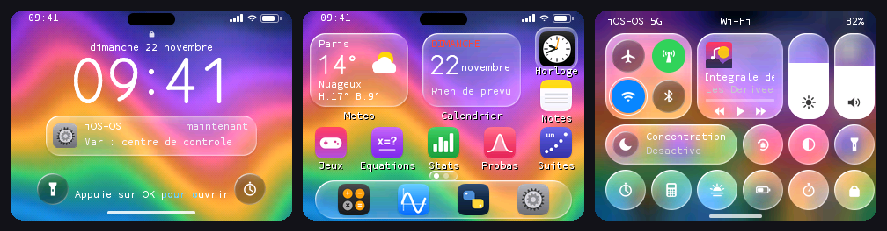

<p align="center">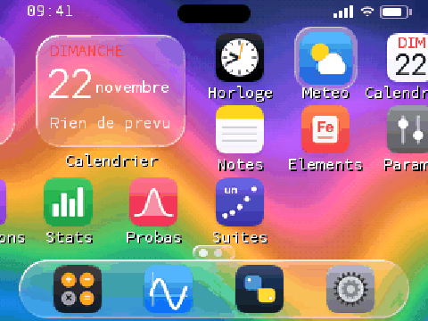</p>

> Captures prises dans le simulateur (heure réglée sur 09:41, batterie
> affichée à 82 %). Sur la calculatrice, tes jeux `.nwa` ont leur propre
> icône.

## L'écran d'accueil

- **Écran verrouillé** : grande horloge, date, une notification, les
  boutons lampe torche et minuteur. **OK** déverrouille : l'écran glisse vers
  le haut et les icônes arrivent une à une.
- **Pages d'icônes** : 5 × 3 icônes par page, les points de page dans une
  pastille de verre, les pages glissent avec un effet ressort. L'icône
  choisie grossit et se pose sur un halo de verre.
- **Widgets** (page 1) : Météo et Calendrier, en verre liquide.
- **Icônes vivantes** : l'icône Horloge donne l'heure (les aiguilles
  tournent), l'icône Calendrier affiche le jour.
- **Dock en verre liquide** : Calculs, Fonctions, Python, Réglages.
- **Dynamic Island** : elle s'agrandit pour la lampe torche, le mode
  Concentration, le chargeur branché, la musique (avec l'égaliseur), le
  chrono et le minuteur en cours.
- **Notifications** : une bannière en verre descend du haut (minuteur
  terminé…).

### Le verre liquide

Le dock, les widgets, les tuiles du centre de contrôle et les notifications
sont en **verre liquide** calculé en vrai, pixel par pixel :

- ce qui est derrière est **flouté** (une copie floue de l'écran est faite
  quand le centre de contrôle s'ouvre) ;
- les bords **réfractent** le fond comme une lentille ;
- un **reflet** brillant suit le bord, plus fort en haut à gauche, d'où
  vient la lumière ;
- un léger dépoli blanc (ou sombre en mode sombre).

## Le centre de contrôle

**Haut depuis la première ligne d'icônes** (comme tirer l'écran vers le bas
depuis le haut) ou **Var** n'importe où. Les tuiles descendent une à une
sur l'écran flouté.

| Tuile | Ce qu'elle fait |
| --- | --- |
| Mode Avion, Données cellulaires, Wi-Fi, Bluetooth | interrupteurs (la barre d'état suit) |
| Musique | lecture / pause (**OK**), morceau suivant (**⌫**), précédent (**boîte à outils**), titre qui défile |
| **Luminosité** | **la vraie luminosité de l'écran** (Haut / Bas) |
| Volume | Haut / Bas, « Mode silence » dans la Dynamic Island |
| Concentration | Ne pas déranger (lune dans la barre d'état) |
| Verrouillage de la rotation | interrupteur |
| **Mode sombre** | tout iOS-OS passe en sombre, fond d'écran compris |
| **Lampe torche** | **allume le voyant de la calculatrice en blanc** |
| Minuteur, Chronomètre | ouvrent l'Horloge sur le bon onglet |
| Calculs | ouvre l'appli Calculs |
| **Night Shift** | **couleurs chaudes sur tout l'écran** |
| **Économie d'énergie** | baisse la luminosité, batterie jaune, animations plus lentes |
| Verrouiller | revient à l'écran verrouillé |

Le centre de contrôle se ferme avec **Retour**, **Var** ou **Haut** depuis
la rangée du haut (on le repousse).

| Écran verrouillé | Accueil | Centre de contrôle |
| --- | --- | --- |
| 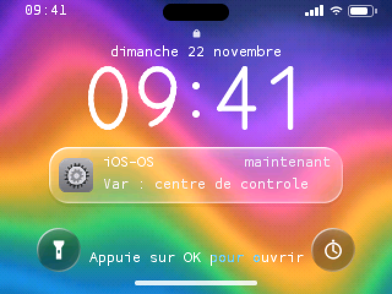 | 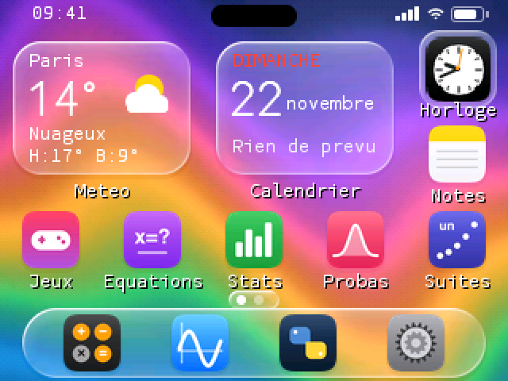 | 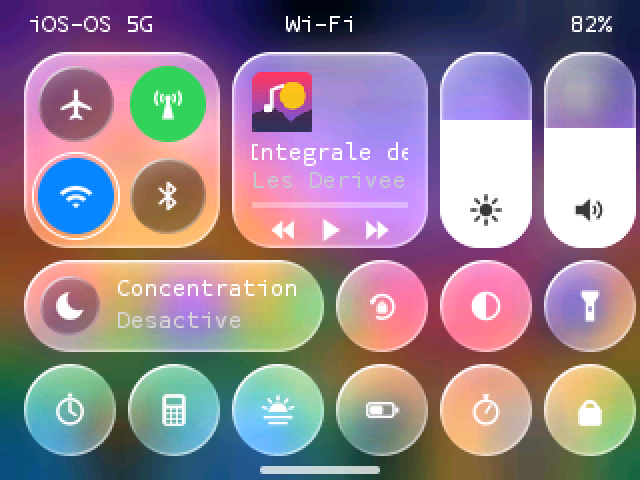 |

<p align="center">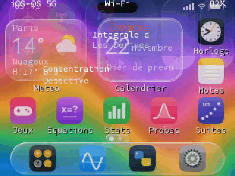</p>

## Les applis iOS-OS

| Appli | Ce qu'elle fait |
| --- | --- |
| **Réglages** | Mode Avion, Wi-Fi, Bluetooth, Concentration, **Luminosité et affichage** (clair / sombre, luminosité, Night Shift, économie), **Fond d'écran** (4 fonds), **Batterie** (niveau, tension, en charge), **Date et heure**, Informations, et les paramètres de la calculatrice. Les pages glissent comme sur iOS |
| **Horloge** | horloge à aiguilles et heure du monde (Paris, New York, Tokyo, Sydney), **chronomètre** avec tours, **minuteur** avec anneau animé (à la fin : notification et voyant qui clignote) |
| **Météo** | 4 villes (gauche / droite), ciel animé (soleil qui tourne, nuages, pluie, étoiles), prévisions heure par heure et des jours suivants en verre liquide. *La calculatrice n'a pas Internet : la météo est inventée.* |
| **Calendrier** | le mois, aujourd'hui en rouge, les jours fériés, déplacement jour par jour ou semaine par semaine |
| **Notes** | jusqu'à 6 notes, écrites au clavier (les lettres sont verrouillées en mode alpha pendant l'écriture) |
| **Jeux** | tes jeux `.nwa`, avec leur icône et un bouton OUVRIR |

| Réglages | Affichage | Fond d'écran |
| --- | --- | --- |
| 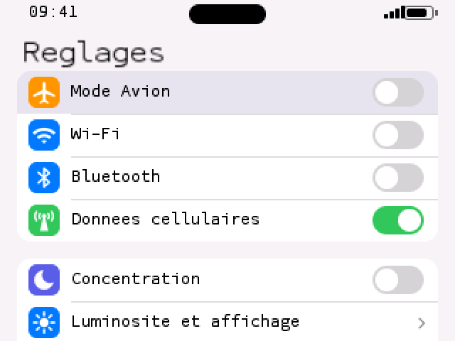 | 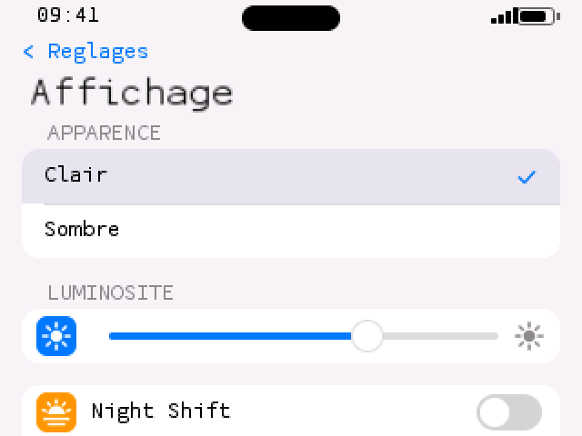 | 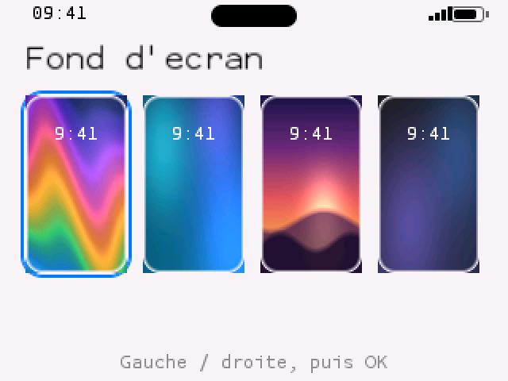 |

| Horloge | Chronomètre | Minuteur |
| --- | --- | --- |
| 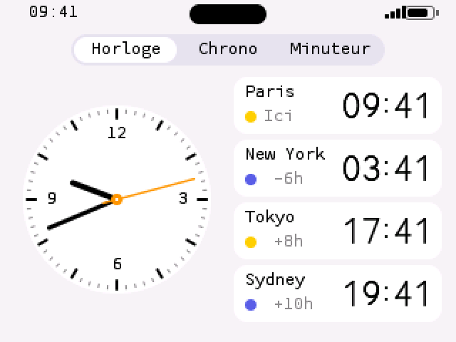 | 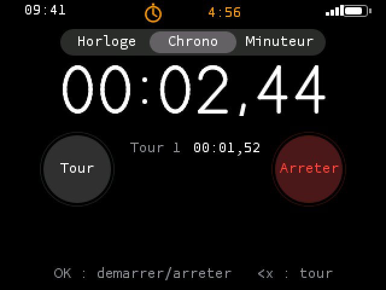 | 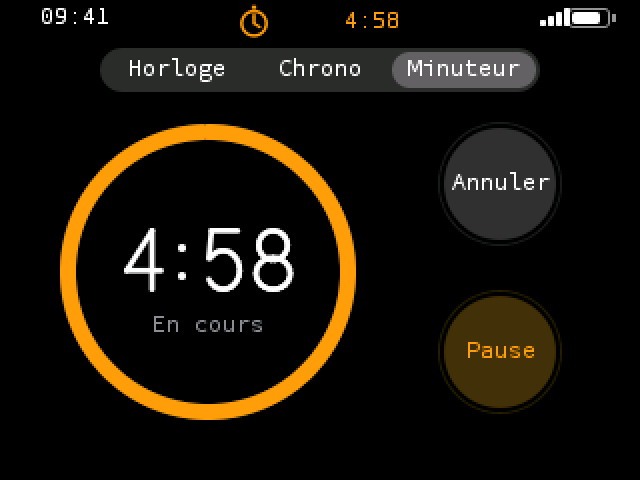 |

| Météo | Calendrier | Notes |
| --- | --- | --- |
| 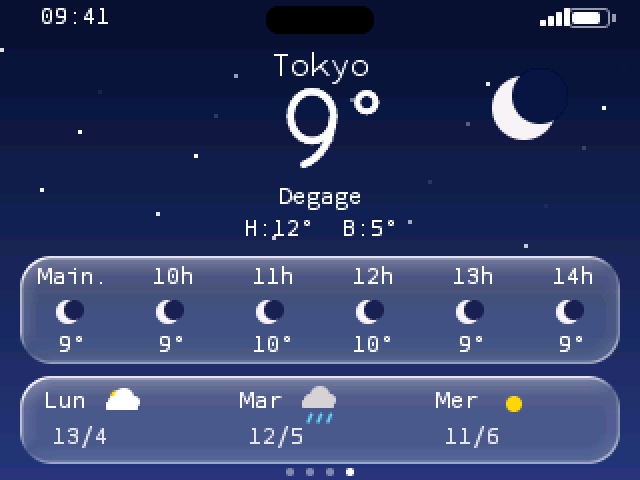 | 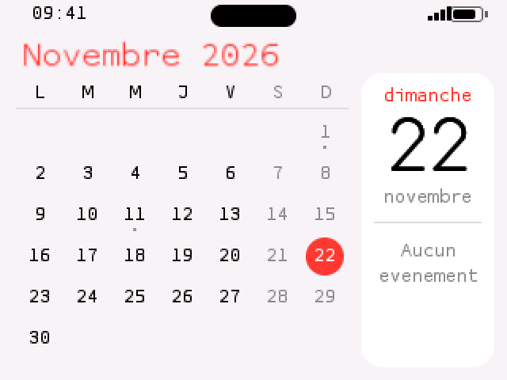 | 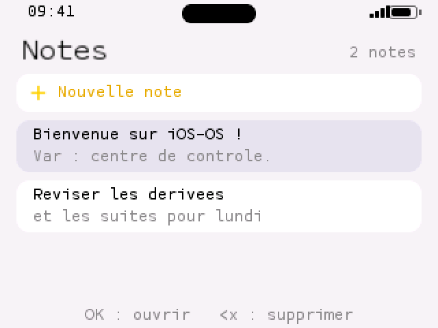 |

| Mode sombre | Night Shift | Notification |
| --- | --- | --- |
| 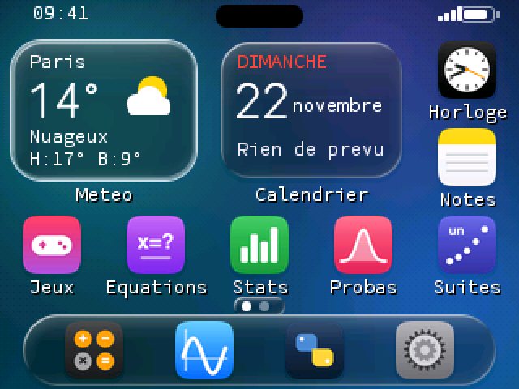 | 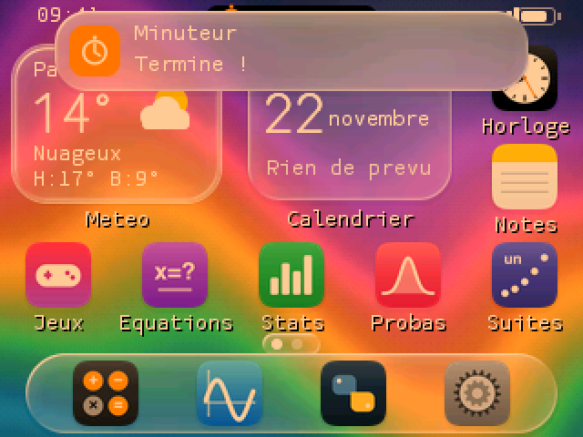 | 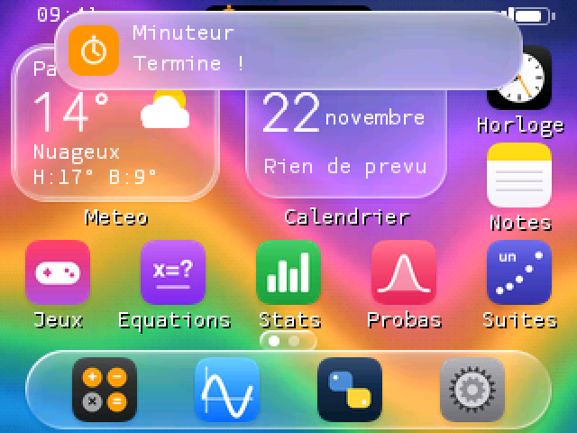 |

## Commandes

| Touche | Écran verrouillé | Accueil | Appli iOS-OS | Centre de contrôle |
| --- | --- | --- | --- | --- |
| Flèches | Gauche : lampe, Droite : minuteur | choisir une icône, changer de page | naviguer | choisir une tuile, Haut / Bas sur les curseurs |
| Haut (rangée du haut) | déverrouiller | **centre de contrôle** | — | fermer |
| OK ou EXE | déverrouiller | ouvrir | valider | activer |
| Var | centre de contrôle | centre de contrôle | centre de contrôle | fermer |
| Retour | — | revenir à la page 1 | page précédente, puis accueil | fermer |
| Home | — | revenir à la page 1 | accueil | fermer |

## Installation

### 1. Obtenir iOS-OS

Depuis juillet 2021, le code d'Epsilon (le logiciel de la NumWorks) n'est plus
sous licence libre. iOS-OS ne publie donc **aucun code ni aucun firmware de
NumWorks** : seulement un **patch** (`patches/ios-os-epsilon.patch`) et son
propre code. Le firmware se compile à partir des sources officielles de
NumWorks, dans ton compte GitHub ou sur ton Mac.

**Sans rien compiler (Mac ou Windows)**

1. En haut de cette page : **Use this template** > **Create a new
   repository**, coche **Private** (obligatoire : la compilation refuse de
   tourner dans un dépôt public, pour que le firmware ne soit pas
   téléchargeable par tous).
2. Facultatif : ajoute tes jeux `.nwa` dans le dossier `games/` de ta copie
   privée (*Add file* > *Upload files*).
3. Dans ta copie : onglet **Actions** > **Build iOS-OS** > **Run workflow**.
4. Environ 30 minutes plus tard (un firmware par modèle), en bas de la page
   de la compilation, télécharge **iOS-OS-Mac** ou **iOS-OS-Windows** et
   décompresse-le (deux fois pour la version Mac : GitHub met le zip dans un
   zip).

**En compilant sur ton Mac**

```bash
brew install make dfu-util libusb
brew install --cask gcc-arm-embedded
git clone https://github.com/derim00/ios-os.git && cd ios-os
./scripts/build-firmware.sh
```

Le script télécharge Epsilon au commit indiqué dans `EPSILON_COMMIT`,
applique le patch, compile, prépare les jeux de `games/` et remplit le
dossier `installer/`.

### 2. Installer sur la calculatrice

**Sur Mac**

1. Une seule fois : `brew install libusb dfu-util` (et
   `brew install --cask gcc-arm-embedded` pour ajouter d'autres jeux).
2. Double-clique sur **`Installer iOS-OS.command`** (la première fois :
   clic droit > **Ouvrir**). La page de l'installateur s'ouvre
   (http://127.0.0.1:8775).

**Sur Windows** (rien à installer : ni Python, ni pilote)

1. Décompresse **iOS-OS-Windows** (clic droit > *Extraire tout*).
2. Double-clique sur **`Installer iOS-OS.exe`** (si SmartScreen s'affiche :
   *Informations complémentaires* > *Exécuter quand même*). Laisse la
   fenêtre noire ouverte, ferme-la à la fin pour quitter.

**Ensuite, sur les deux**

3. Branche la calculatrice en USB et appuie sur **Reset** au dos : elle
   redémarre sur le système officiel.
4. Quand le voyant passe au vert, glisse tes jeux `.nwa` dans la page si tu
   veux, puis clique sur **Installer iOS-OS**.

Seul le **slot B** est écrit : le système officiel (slot A) n'est jamais
modifié.

## À savoir

- **Calculatrice** : NumWorks **n0110**, **n0115** ou **n0120**, logiciel
  officiel **26.4.0** dans le slot A. L'installateur choisit tout seul le
  firmware du modèle branché.
- **Un seul système dans le slot B** : iOS-OS remplace Wii U-OS, Mint-OS,
  Windows-OS, Switch-OS, PSP-OS… (et inversement). Les installateurs peuvent
  tourner en même temps (iOS-OS utilise le port 8775).
- **Après un Reset**, la calculatrice revient sur le système officiel et
  iOS-OS repart de zéro (réglages, notes) : il suffit de relancer
  l'installation.
- **Horloge** : la calculatrice n'a pas d'horloge ; règle l'heure et la date
  dans Réglages > Date et heure.
- **Accents** : la police de la NumWorks n'a pas de lettres accentuées ; les
  textes s'affichent sans accents.
- **Wi-Fi, Bluetooth, Météo, Musique** : la calculatrice n'a ni radio, ni
  Internet, ni haut-parleur ; ces réglages et ces données sont pour le style.
  La **luminosité**, la **lampe torche** (voyant), **Night Shift**, le **mode
  sombre**, l'**économie d'énergie**, l'**horloge**, le **chrono** et le
  **minuteur** marchent pour de vrai.
- **Home et On/Off** : le correctif du plantage Home / On-Off de Windows-OS
  est repris. Home ramène toujours à l'écran d'accueil.
- **Jeux** : seulement des applis `.nwa` dont tu as le droit de te servir, et
  uniquement dans ta copie privée : jamais dans un dépôt public.

## Comment c'est fait

| Fichier (dans le patch) | Rôle |
| --- | --- |
| `apps/home/ios/shell.cpp` | écran verrouillé, pages d'icônes, widgets, dock, Dynamic Island, barre d'état, centre de contrôle, notifications, transitions |
| `apps/home/ios/apps.cpp` | Réglages, Horloge, Météo, Calendrier, Notes, Jeux |
| `apps/home/ios/gfx.cpp` | rendu par bandes en RAM, **verre liquide** (flou, réfraction, reflets), fonds d'écran lissés et tramés, chiffres vectoriels, traits et anneaux anti-crénelés, Night Shift |
| `apps/home/ios/gen_icons.py` | dessine toutes les icônes dans `ios_icons.h` |
| `escher/src/run_loop.cpp` | animations : l'appli d'accueil peut demander une image toutes les 40 ms |
| `scripts/photos.py` | transforme la séance photo du simulateur (`IOS_SHOTS=dossier`) en PNG et GIF |

## Licence

Le code d'iOS-OS est sous licence **CC BY-NC-SA 4.0** (voir `LICENSE`).
Epsilon reste la propriété de NumWorks et n'est pas inclus dans ce dépôt.
iOS-OS est un projet de fan, sans lien avec Apple ni avec NumWorks ; iOS,
iPhone et Dynamic Island sont des marques d'Apple. Les icônes, les fonds
d'écran et les morceaux de musique (inventés) sont des créations originales
faites pour ce projet : aucune image, aucun logo ni aucun code d'Apple n'est
utilisé.
